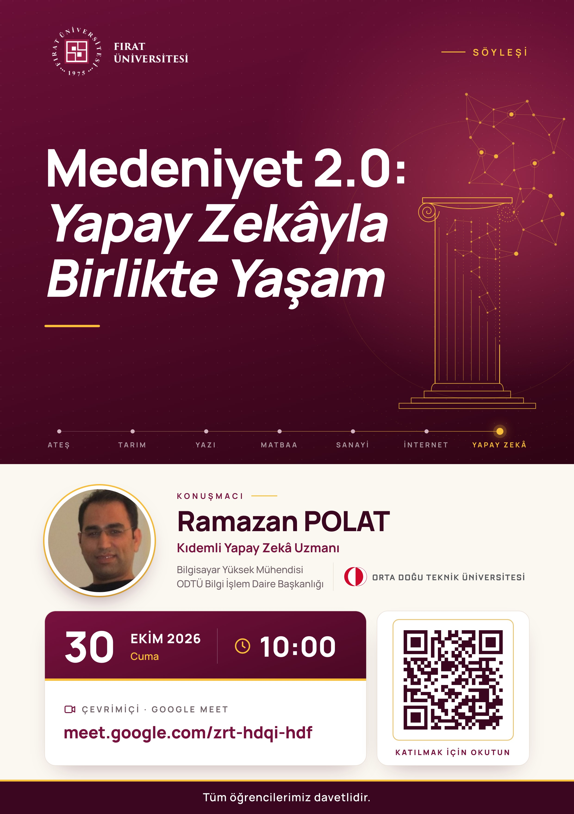

# Medeniyet 2.0 (Civilization 2.0)

> Görüntülü arama bayramlaşmamızı nasıl değiştirdiyse, yapay zekâ da hayatımıza yeterince yerleştiğinde yaşam şeklimizi değiştirecek. Ajanlara, insan olmadıklarını bilerek ama insanmış gibi davrandığımız o noktaya ben **Medeniyet 2.0** diyorum.

Bu depo, **Medeniyet 2.0** tezini, merkezi bilgi tabanını (`kb/`), üç ayrı yapay zekâ ajanının (`claude`, `codex`, `agy`) bağımsız çalışma alanlarını (`agents/`) ve söyleşi/sunum çıktılarını (`talks/`) barındırır.

---

## Fırat Üniversitesi Söyleşisi — Yapay Zekâyla Birlikte Yaşam

**30 Ekim 2026 Cuma, 10:00 · Fırat Üniversitesi · Çevrim içi söyleşi** 
**Konuşmacı:** Ramazan POLAT (ODTÜ) · **Durum:** Gerçekleşti

**[Sunulan sunum — 17 slayt](talks/2026-10-30-firat/slaytlar.html)** · **[İçerik, akış ve konuşmacı notları](talks/2026-10-30-firat/icerik.md)** · **[Etkinlik kaydı](talks/2026-10-30-firat/README.md)**

HTML sunumunu indirip tarayıcıda açabilirsiniz; dosya, sunum ve konuşmacı notlarını birlikte içerir.

  

### Söyleşinin İçeriği

**Bir aracı kullanmaktan, onunla birlikte yaşamaya:** Yapay zekânın gündelik hayattaki yeri, açtığı çalışma alanları, kullanımının bedelleri ve insan ilişkilerinde oluşturduğu yeni beklentiler.

- **Neredeyiz?** Yapay zekâ kullanımını hayatımızdaki payıyla düşünmek; kullanım dağılımı ve dinleyicinin kendi konumu.
- **Nereye gidiyor?** Yeni çalışma alanları ve sevdiğimiz işe yapay zekâyı katmak.
- **Bedeli ne?** Zaman, para, düşünmeyi devretme ve bizi sürekli haklı çıkaran bir yardımcıyla çalışmak.
- **Kurallar:** Yapay zekâyı hayatımıza katarken beş kullanım kuralı.
- **Medeniyet 2.0:** Kişisel ajanlar, değişen insan ilişkileri ve birlikte oluşturacağımız yeni görgü.

Tam ekran metinleri ve anlatım notları [etkinliğin içerik belgesinde](talks/2026-10-30-firat/icerik.md) yer alır.

---

## Dizin Haritası

| Alan | Yol | Açıklama |
|---|---|---|
| **Merkezi Bilgi Tabanı** | [`kb/`](kb/README.md) | Ortak kanon: [`THESIS.md`](kb/THESIS.md), [`journal.md`](kb/journal.md), cümle/hikâye/terim bankası ([`kb/bank/`](kb/bank/)) ve birincil kaynaklar ([`kb/sources/`](kb/sources/)). |
| **Ajan Stüdyoları** | [`agents/claude/`](agents/claude/README.md) | Claude Code'un bağımsız `living-docs` çalışma alanı. |
| | [`agents/codex/`](agents/codex/README.md) | Codex'in bağımsız `living-docs` çalışma alanı. |
| | [`agents/agy/`](agents/agy/README.md) | Antigravity'nin bağımsız `living-docs` çalışma alanı. |
| **Söyleşiler & Sunumlar** | [`talks/2026-10-30-firat/`](talks/2026-10-30-firat/README.md) | Gerçekleşen 30 Ekim 2026 Fırat Üniversitesi söyleşisi: sunulan sunum ([`slaytlar.html`](talks/2026-10-30-firat/slaytlar.html)), içerik ve anlatım notları ([`icerik.md`](talks/2026-10-30-firat/icerik.md)) ve afiş ([`afis/`](talks/2026-10-30-firat/afis/)). |

---

## Çalışma Düzeni (`living-docs`)

Her alt alan (`kb/`, `agents/*/`, `talks/*/`) **`living-docs`** kuralına uyar:
- **Kök dizin yalnızca güncel olanı tutar:** Kabul edilmiş tek güncel sürüm kök dizinde yaşar; taslaklar `-draft` ekiyle yanında durur.
- **`history/` geçmişi tutar (salt okunur):** Yürürlükten kalkan sürümler silinmez, ilgili alanın `history/` klasörüne taşınır.
- Ayrıntılı kurallar için bkz. [`AGENTS.md`](AGENTS.md).
